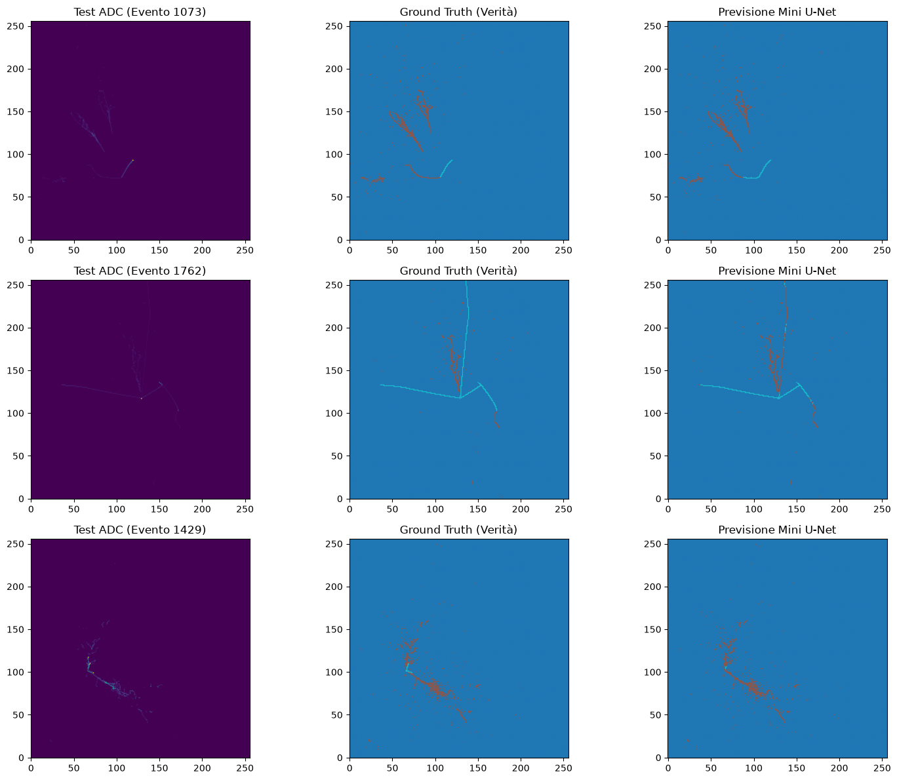

# 2D U-Net for LArTPC Semantic Segmentation & Event Classification

A lightweight PyTorch implementation of a 2D U-Net pipeline, inspired by the [**SPINE**](https://github.com/DeepLearnPhysics/spine) (*Scalable Particle Imaging with Neural Embeddings*) reconstruction workflow, for pixel-level semantic segmentation and event classification in Liquid Argon Time Projection Chambers (LArTPC).

## Physics motivation

Liquid Argon TPC detectors (such as SBND, ICARUS and DUNE) record high-resolution topological images of neutrino–argon interactions. Automated event reconstruction relies on separating track-like particles (muons, protons, pions) from electromagnetic showers (electrons, photons) and on classifying the overall interaction topology directly from sparse detector projections.

## Repository contents

| File | Description |
|---|---|
| `ML.ipynb` | Main end-to-end pipeline: data loading and preprocessing from the Deep Learn Physics LArTPC dataset, lightweight 2D U-Net definition, GPU training loop, quantitative evaluation and event-display visualizations. |
| `miniSPINE2000.ipynb` | Exploratory experiments: data/feature inspection and baseline model prototyping. |
| `miniSPINE_unet_weights.pth` | Pre-trained PyTorch weights, ready for inference without retraining. |
| `minispine_train.h5`, `minispine_test.h5` | Training and test data used by the notebooks. |
| `miniSPINE.png` | Figure. |
| `requirements.txt` | Python dependencies. |


## Model & pipeline

- **Framework:** PyTorch, trained with CUDA GPU acceleration.
- **Architecture:** lightweight symmetric 2D U-Net with encoder–decoder blocks, skip connections, Batch Normalization and ReLU activations.
- **Dataset:** Deep Learn Physics public LArTPC dataset (simulated LArTPC events).
- **Tasks:**
  1. **Pixel-level semantic segmentation:** separating background, track-like hits and electromagnetic-shower hits.
  2. **Event classification:** categorizing the event topology from the learned representations.


## Data

| Split | File | Events |
|---|---|---|
| Train | `practice_train_2k.root` |
| Test | `practice_test_2k.root` | 


## Results



| Metric | Value |
|---|---|
| Pixel accuracy | TODO |
| Per-class IoU / Dice (background, track, shower) | TODO |
| Event-classification accuracy | TODO |

## How to run

1. Clone the repository:

   ```bash
   git clone https://github.com/aleilpro/lartpc-unet-reconstruction.git
   cd lartpc-unet-reconstruction
   ```

2. Install the dependencies (PyTorch, NumPy, Matplotlib, scikit-learn, uproot, awkward, h5py, tqdm):

   ```bash
   pip install -r requirements.txt
   ```

3. Download the dataset files (`practice_train_2k.root`, `practice_test_2k.root`) from the Deep Learn Physics open data repository and set the input path in the first cells of the notebook.

4. Open `ML.ipynb` to reproduce training and evaluation, or load `miniSPINE_unet_weights.pth` to run inference without retraining.


## Acknowledgements

- [SPINE](https://github.com/DeepLearnPhysics/spine) (DeepLearnPhysics), which inspired the reconstruction workflow.
- Deep Learn Physics, for the public LArTPC dataset.

## Author

Alessio Proietti — M.Sc. student in Experimental Particle Physics, Università degli Studi Roma Tre.

## License

The code is released under the MIT License, see [LICENSE](LICENSE). The dataset and SPINE are subject to their own licenses.
